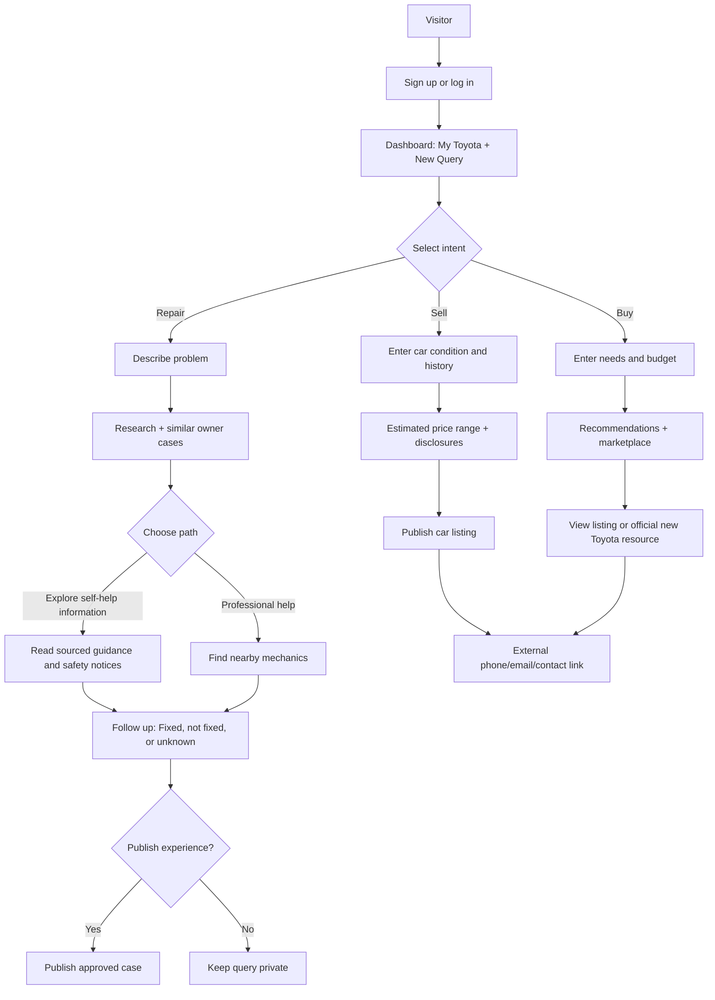

# Toyota Owner Hub — Project Description and Build Specification

> **Document purpose:** This is the primary project brief for human teammates and AI coding agents. It defines the intended application, user journeys, feature priorities, data responsibilities, constraints, and implementation boundaries for our HackTX 2026 prototype.
>
> **Project status:** Concept / implementation specification. Features described here are requirements or proposals, **not claims that they have already been built**.
>
> **Primary focus:** **Repair**. **Sell** and **Buy** are secondary paths that reuse the same vehicle, issue-history, and community information.

## 1. Product vision

Build a **Toyota-focused owner platform** that helps people **repair, sell, or buy** a vehicle using an AI assistant, relevant owner experiences, public web information, and a connected marketplace.

Users sign in and create a **new query** by choosing one of three intents:

1. **Repair** — Describe a Toyota problem; explore potentially relevant solutions and other owners' experiences; decide whether to investigate independently or get professional help; optionally share the outcome.
2. **Sell** — Describe a Toyota they own, including its condition and repair history; see an **evidence-based estimated listing-price range**; publish a used-car listing with an external contact method.
3. **Buy** — Specify vehicle needs and budget; receive Toyota-focused recommendations; browse other users' used Toyota listings; optionally explore new Toyota models and official dealer resources; contact sellers **outside the application**.

The connecting idea: **a vehicle's issue and repair history can inform future ownership, resale, and purchase decisions**. The AI helps users interpret information and discover relevant experiences; it does **not** guarantee a repair diagnosis, a sale price, or a vehicle's condition.

### One-line pitch

**One Toyota community for what comes next: understand a problem, find help, document the outcome, and buy or sell with better context.**

### The main differentiator

Not just a Toyota-only forum and not just a car marketplace. The same structured records can support an owner's journey:

`Reported issue → Related owner experiences → Repair outcome → Vehicle history → Seller disclosure → Buyer research`

This is a **proposed** advantage, not an established competitive moat. Real adoption, trustworthy records, privacy controls, and up-to-date data would be needed to prove it.

---

## 2. Who uses the application?

| Actor | Needs | Main actions |
|---|---|---|
| Toyota owner with a problem | Understand possible causes, safety urgency, and options | Create repair query, search, compare experiences, request professional help, record outcome |
| Toyota owner with relevant experience | Share what happened without disclosing private details | Publish optional case or reply; update reported outcome |
| Toyota seller | Present the vehicle, its condition, and price realistically | Create listing, review estimated range, choose external contact information |
| Prospective Toyota buyer | Compare vehicle options and understand known issues | Enter budget/preferences, browse listings, research issues, contact sellers externally |
| Administrator (later) | Improve trust and mitigate abuse | Moderate suspicious posts and listings, respond to reports |

The platform is **Toyota-focused at launch**. Do not silently expand to all vehicle brands.

---

## 3. Navigation and general flow



**Important:** Branching into Buy or Sell starts a **new query**. A repair query does not automatically become a listing. A user can return later and reuse their confirmed vehicle details and selectively disclosed history.

---

## 4. Shared application features

### 4.1 Account and dashboard

- Sign up / log in / log out.
- Dashboard with **New Query** buttons: **Repair**, **Sell**, **Buy**.
- View the user's prior queries and their status.
- Add an optional **My Vehicles** profile (year, model, trim if known, mileage, ownership type). A user can own or interact with multiple cars.
- Store saved cases, saved listings, and relevant past interactions as appropriate.
- Users can edit or delete their own records subject to integrity/privacy rules.

### 4.2 Persistent query records

Every query stores:

- `user_id`, `query_id`, `intent` (`repair | sell | buy`), created/updated times.
- Explicitly submitted inputs and optional vehicle association.
- Structured AI extraction, if available; distinguish AI interpretation from user-confirmed facts.
- Relevant source links and retrieval timestamps.
- Status (e.g., `open`, `resolved`, `listed`, `closed`).
- Visibility (`private` by default; public only when explicitly published).

### 4.3 AI assistant behavior

The AI supports intake, clarification, source synthesis, matching, and recommendations. It should:

1. Identify whether the user wants **Repair**, **Sell**, or **Buy**.
2. Ask only for the key missing details needed for that intent.
3. Turn user messages into structured fields for searchable records.
4. Query relevant stored cases and/or external sources.
5. Present results in ordinary language with links, uncertainty, and clear distinctions between facts and anecdotes.
6. Ask for user confirmation before publishing anything or carrying assumptions into consequential calculations.

**AI learning clarification:** The app may save a private user's query and its structured context to help **that same user** continue later, even if they decline to publish. It must **not silently train a shared model on private conversations or expose one person's private issue to other users**. For cross-user improvements, only use explicitly public cases, licensed public material, or **separately opted-in, appropriately de-identified** signals. In the hackathon, “learning” means retrieving and matching permitted data (RAG/database search), **not fine-tuning model weights on every chat**.

---

## 5. Core flow A: REPAIR — highest priority

### 5.1 User intake

A logged-in user selects **New Query → Repair**.

Ask for:

- Toyota year and model (required if known).
- Mileage (optional).
- Problem description (required) via text; image upload and voice input if working within time.
- When the issue occurs and observable symptoms, when relevant.
- Whether the problem involves immediate safety concerns.

Example: “My 2018 Toyota Camry makes a squealing sound when I brake.”

The assistant creates a **structured issue**, not a confirmed diagnosis. It may ask follow-up questions, such as whether braking performance has changed.

### 5.2 Find possible information and related cases

Search two **separate** information streams:

**A. Internal community cases**

- Match by model/year where possible, symptoms, keywords, and reported circumstances.
- Show comparable cases with their **reported outcome**, status, and relevant differences.
- Link to a public owner post only if its author explicitly published it.
- Never expose private chat logs or imply that matching symptoms prove an identical cause.

**B. External web research**

- Use SerpApi to retrieve results about the model/year/symptom.
- Prioritize official Toyota information, NHTSA recall lookup, manuals, and reputable service sources when relevant.
- Community forums can provide examples, **not verified technical facts**.
- Display URLs and retrieval dates. For VIN-specific recalls, direct users to official recall lookup rather than asserting applicability.

Every result should be visibly labeled, such as **Official information**, **Community-reported experience**, or **Other public resource**.

### 5.3 Choose a repair-help path

After reviewing evidence, present two choices:

#### Option 1 — Explore self-help information

- Show relevant **sourced** checks or service information in plain language.
- Provide limitations and safety notices.
- Do **not** offer step-by-step instructions for hazardous repairs when the situation calls for qualified help.
- Ask whether this information helped and whether the issue is actually fixed.

#### Option 2 — Find a mechanic

- Ask permission to use approximate location or request city/ZIP; never assume precise location access.
- Use a real nearby-business search where available to show relevant service providers, addresses, and external websites or phone information.
- Explain that proximity, reviews, and relevance do not prove the mechanic can fix this exact issue.
- Show what other owners **reported** doing in comparable cases, without claiming their repairs were professional confirmations.
- Booking, calling, or payment can happen outside the application. **Do not build mechanic appointment scheduling** for the MVP.

### 5.4 Repair follow-up and outcome

After assistance, ask:

**“Was the problem fixed?”**

Options:

- **Yes, fixed** — optionally record what was done, who performed it (self/professional), cost if known, and the user's confidence/evidence.
- **No, not fixed** — keep the issue open and allow a follow-up description.
- **Not sure / still investigating** — save as unresolved without forcing a conclusion.

Then ask:

**“Would you like to share your experience as a public post so other Toyota owners can learn from it?”**

- **Yes:** Show a preview, remove private fields by default, require explicit publish confirmation, then create the public case.
- **No:** Keep the issue and history **private to that user**. Do not publish or identify the user in recommendations.
- Users should be able to update the outcome or change visibility later.

A public case can include vehicle context, symptoms, attempts, the reported outcome, optional cost, and a timestamp. A label like **“Owner-reported fix”** is accurate; **“verified safe repair”** is not unless independently supported.

### 5.5 Repair flow — acceptance criteria

- A user can create and revisit a repair query.
- Real AI extracts symptoms into structured data without inventing a definite fault.
- The app can find relevant internal cases and actually execute an external search.
- Users can choose self-help resources or real nearby repair businesses.
- Users can mark fixed/unfixed/uncertain.
- Posting is explicit and optional; declining keeps the case private.
- No high-risk symptom receives an unwarranted assurance that driving is safe.

---

## 6. Core flow B: SELL — secondary priority

### 6.1 Create a sale query

Select **New Query → Sell**. Collect:

- Toyota year, model, trim, mileage, location (city/region), title/ownership status as appropriate.
- Vehicle condition (mechanical, exterior, interior).
- Known damage, problems, outstanding repair needs, and maintenance/repair history **that the seller chooses to disclose accurately**.
- Photos and an optional description.
- An asking-price preference.
- External contact method (phone, email, or another explicitly chosen link).

If the user has a saved Toyota vehicle and prior repair queries, offer to **import their confirmed information** into the listing. **Never automatically publish private issues or chat transcripts.** Allow the seller to review and edit disclosure details, and encourage accurate statements about known material problems.

### 6.2 Price research and estimate

The application may use SerpApi to retrieve comparable **current asking-price listings**, then produce an **indicative listing-price range**, not an asserted fair market value or guaranteed sale amount.

Suggested algorithm for MVP:

1. Filter comparables by Toyota model, year range, mileage range, geographic relevance, and trim where possible.
2. Show the source listings and how many meaningful comparisons were found.
3. Derive a transparent baseline such as a median asking price **only when sufficient comparable data exists**.
4. Consider condition and disclosed damage using **user-entered, explicitly hypothetical adjustment amounts**, or published, supported adjustment data where available.
5. Display assumptions, missing information, and a broad range. If comparables are too sparse, say **“Insufficient data for a reliable estimate”** rather than fabricate a number.
6. Let the seller select the final asking price; AI does not post a price without approval.

**Do not invent depreciation percentages or automatically reduce the price for each reported issue.** Repair histories differ greatly; a repaired fault, unresolved damage, and normal maintenance are not equivalent. Distinguish asking prices from completed sale prices.

### 6.3 Create a marketplace listing

The user previews and publishes:

- Toyota details and condition.
- Photos, seller-approved description, asking price.
- Optional verified/owner-reported repairs with precise labeling.
- Preferred external contact method.

Buyers may browse and contact the seller **outside the app**. There is **no in-app checkout, escrow, payment, negotiation chat, or transaction processing** in the MVP.

For safety, contact details should be intentionally displayed only when the seller opts in; clearly warn about scams and do not make a phone number mandatory for the public profile.

### 6.4 Sell flow — acceptance criteria

- Seller can create, edit, and remove their own listing.
- Listings reference their underlying vehicle without exposing private query records.
- AI can explain its assumptions and show comparable listing links; if inadequate data, it does not generate an unjustified price.
- Seller explicitly chooses the asking price and approves public details.
- Buyer can use the seller's permitted external contact method.

---

## 7. Core flow C: BUY — secondary priority

### 7.1 Buyer intake

Select **New Query → Buy**. Ask:

- Budget or preferred price range.
- Preferred Toyota model/body style (or “not sure”).
- New, used, or either.
- Optional mileage, year, fuel efficiency, seating, and general preferences.
- Location (city/ZIP) only if needed for nearby inventory.

### 7.2 Recommendations and browse

Two paths:

**Used Toyotas — community marketplace**

- Browse/search user-created Toyota sale listings.
- Filter by asking price, model, year, mileage, and approximate location.
- Open details and read seller-approved vehicle condition and disclosed history.
- The AI can compare options against budget/preferences and highlight known uncertainties.
- Contact the seller using the chosen **external** method.

**New Toyotas — research and recommendations**

- Show model options that plausibly fit needs and budget.
- Link to official Toyota model/dealer pages for current pricing and availability where obtainable.
- Do not invent local inventory, MSRP, financing terms, incentives, or loan eligibility.
- Purchases occur outside the app.

### 7.3 Buy flow — acceptance criteria

- Buyer can save preferences and browse actual existing listings.
- Real filters work; no fake seller profiles or hidden simulated inventory.
- AI recommendations explain which user-provided preferences each option satisfies.
- External contact and official links work without in-app transactions.

---

## 8. Community and knowledge model

The community is primarily **a searchable collection of published experiences**, not a full Reddit replacement.

An owner-reported case may contain:

- Vehicle details and symptoms.
- The user's investigation and action taken.
- Who completed the work, if reported.
- Cost paid or quoted, if voluntarily provided.
- Status: fixed, unresolved, uncertain.
- Source and evidence flags; published date and updates.
- Optional comments/questions if time permits.

**Private records** can improve continuity for the original account but **cannot appear in public search, another user's AI response, or public listings** without authorization.

**Cross-user matching hierarchy:**

1. Public, permissioned internal owner cases.
2. Relevant official sources and permitted public web content.
3. Unverified community reports labeled clearly as anecdotal.

No automatic attribution of a private user, no fabricated discussions, and no representation that private chats have trained the AI.

---

## 9. Data architecture (proposed)

Recommended 24-hour stack:

- **Frontend:** React + TypeScript + Vite + Tailwind CSS.
- **Backend:** FastAPI + Pydantic.
- **Database/auth/storage:** Supabase (PostgreSQL, Auth, Storage). Use row-level access rules and server-side credentials appropriately.
- **AI:** Gemini API for structured intake, explanation, and optional image/voice processing **only after confirming available endpoints and quotas**.
- **Research:** SerpApi for real web results/comparable listings; source links and retrieval times must be stored.
- **Mechanic discovery:** A supported places/local-business search integration where available; validate business results.
- **Optional Meta:** Muse Spark or voice if confirmed accessible, and/or an explicitly consent-based owner-experience interaction. Do not treat sponsor slide descriptions as guaranteed access.

### Minimal logical schema

| Table | Key fields | Visibility/security |
|---|---|---|
| `users` / `profiles` | `id`, display name, preferences | Account-only for private fields |
| `vehicles` | `id`, `owner_id`, model, year, trim, mileage | Private unless selectively linked in a public listing/case |
| `queries` | `id`, `user_id`, `vehicle_id`, `intent`, status, inputs, AI structured summary | Private by default |
| `repair_cases` | `id`, `query_id`, symptoms, resolution status, reported action/cost, `is_public` | Only published, authorized fields visible publicly |
| `case_comments` | `id`, `case_id`, `author_id`, text | Only on public cases; optional MVP |
| `sale_listings` | `id`, seller ID, vehicle snapshot, condition, photos, asking price, approved contact | Public after explicit publication |
| `buyer_preferences` | `id`, user ID, budget, desired features | Private |
| `saved_items` | user ID, case/listing ID, type | Private |
| `research_sources` | query ID, URL, source type, title, retrieved time | Inherit query visibility; do not expose private query details |

Maintain a **snapshot of the publicly disclosed vehicle details** in each sale listing so editing a private vehicle profile cannot unexpectedly modify what buyers see. Public cases should likewise have approved published fields separate from raw private chat content.

### Suggested API surface

```text
POST   /api/queries                       # New repair/sell/buy query
GET    /api/queries                       # My queries only
GET    /api/queries/{id}                  # Owner-authorized read
POST   /api/repair/analyze                # Structured symptoms + safe response
GET    /api/repair/cases                  # Only public cases
POST   /api/repair/cases/{id}/publish     # Explicit consent / publish
PATCH  /api/repair/cases/{id}/outcome     # Fixed/unfixed/unknown
GET    /api/repair/mechanics             # Location with permission
POST   /api/sell/estimate                 # Source-linked indicative range
POST   /api/listings                      # Seller-approved public listing
GET    /api/listings                      # Filtered listing browse
PATCH  /api/listings/{id}                 # Seller-only changes
POST   /api/buy/recommend                 # Budget / preference matching
```

These are **proposed interfaces**, not already implemented routes. Agree on JSON request/response contracts before coding in parallel.

---

## 10. AI safety, trust, and privacy requirements

1. **No definitive mechanical diagnosis** from an image, noise, or written symptoms. Possible explanations must be qualified and sourced.
2. **Escalate dangerous symptoms** (brake/steering failure, smoke/fire, severe fuel leaks, etc.) and recommend appropriate urgent professional help. Never encourage unsafe continued driving.
3. **Never fabricate mechanics, shop reviews, recall status, comparable listings, prices, vehicle inventory, or owner experiences.**
4. **Visible evidence labels:** official source, third-party source, community-reported experience, or synthetic demonstration case.
5. **Private by default:** A repair chat remains private unless the user publishes an approved case. A seller decides which history appears on a listing.
6. **No silent training on private conversations:** Save conversational context for the account; require separate consent before broader reuse. Respect deletion and data retention choices.
7. **Price estimates are not guarantees:** Show links, assumptions, data freshness, and uncertainty. The seller sets the asking price.
8. **External transactions only:** No payments, escrow, loans, financial commitments, or in-app messaging between buyer and seller in the MVP.
9. **Respect platform and source restrictions:** Do not scrape prohibited content or reproduce third-party discussions as if the authors joined this platform.
10. **Automated explanations are not inspections:** Encourage inspections and official VIN-based checks before a used-car purchase.

---

## 11. HackTX 2026 fit and boundaries

The official opening ceremony describes a **Toyota Financial Services** challenge about answering: *“Given my situation today, what's the smartest next move for me and my Toyota?”* It emphasizes personalized context, simplified payments/costs/trade-offs, clear next steps, and measurable customer/business value.

**Critical fit assessment:** This project is primarily **repair-first**, which does **not automatically satisfy** a financial-services challenge. The **Sell** and **Buy** branches introduce decisions, but a basic used-car marketplace plus troubleshooting assistant may still be a weaker Toyota entry than a dedicated financial decision workflow.

To improve the Toyota-track story **without overbuilding**, add a compact optional **Ownership Next Step** panel:

- For repair: compare user-provided written quotes and likely next actions; check for relevant warranty/recall information without asserting eligibility.
- For sell: explain an evidence-based asking-price range and what unresolved repairs might mean for disclosure and buyer questions.
- For buy: compare asking prices and the buyer's stated budget; highlight inspection, history, and financing questions without inventing loan offers.

The application should **not** claim a strong Toyota Financial Services alignment based on mechanical diagnosis alone.

Potential sponsor alignment:

- **SerpApi:** Relevant for repair research, official information discovery, comparable sale listings, and optional local service lookup.
- **Gemini:** Relevant for understanding text/photos/voice, structuring issues, comparing confirmed user inputs, and explaining evidence.
- **Meta:** Only a convincing fit if real, consensual person-to-person knowledge sharing is part of the working experience. A static forum or generic chatbot alone is weak.
- **Freetail:** A reliable and polished end-to-end demonstration is more valuable than claiming many partially completed integrations.

**Hackathon rule reminder:** The event slides set a maximum of **three selected tracks**, excluding Best Overall and Best Novice, and require hackathon code to be created during the hacking period. Verify eligibility and detailed submission rules before entering.

---

## 12. MVP priorities: 24 hours, four or five developers

### P0 — must ship (complete vertical slice)

1. Auth and dashboard with three query types visible.
2. **Repair**: create problem query, Gemini structured intake, real external search, public-case matching, result view.
3. Repair follow-up: **fixed / not fixed / unsure** and **explicit optional publish**.
4. Database persistence with correct private/public separation.
5. Basic **Sell**: enter condition, manually chosen asking price, publish a listing, external contact.
6. Basic **Buy**: browse and filter those real published listings, external contact.
7. Clear safety warnings, errors, and source links.

### P1 — build after P0 works

1. Source-linked resale asking-price comparison with honest insufficient-data state.
2. Nearby mechanic lookup using approximate location / ZIP.
3. Image intake and voice transcription.
4. Buyer recommendation by budget and selected preferences.
5. Seller-controlled import of selected prior vehicle/repair details.
6. Responsive UI polish, loading states, empty states.

### P2 — only if substantial time remains

- Owner-to-owner comments/questions.
- Meta Muse API integration where actual access is confirmed.
- New Toyota catalog integration with sourced dealer links.
- Enhanced semantic matching, embeddings, maps, moderation dashboards.

### Deliberately out of scope

- A full Reddit-style social feed and reputation system.
- Mechanic appointment scheduling.
- In-app buyer/seller chat, checkout, escrow, or money transfer.
- Automated VIN verification or guaranteed vehicle history.
- Live financing approvals and personalized loan offers.
- Automatic public sharing of repair history.
- Training new foundation models using users' private chats.
- AI-generated guaranteed repair diagnoses or precise resale valuations.

**Scope-cut rule:** If integration falls behind, keep the complete Repair journey and the simplest functional Sell/Buy marketplace flows. Cut P1/P2 before weakening privacy, source truthfulness, or core reliability.

---

## 13. Suggested work allocation

| Role | Primary ownership | Integration dependency |
|---|---|---|
| Dev 1 — Frontend | Auth screens, dashboard, Repair/Sell/Buy UI, responsive styling | Needs backend API contracts |
| Dev 2 — AI/Repair | Gemini adapter, symptom extraction, safe synthesis, matching | Uses query/case schema and research results |
| Dev 3 — Search/Market | SerpApi adapter, evidence links, repair research, pricing research, mechanic lookup if time | Needs structured vehicle/query data |
| Dev 4 — Backend/Data | Supabase schema, authorization, queries, published cases, listings, contact visibility | Defines shared contracts and persistence |
| Dev 5 (if available) — Integration/QA | Tests, deployment, cross-flow debugging, demo, optional Meta | End-to-end integration |

### Implementation order

1. Confirm real API access and write JSON contracts.
2. Create database schema, secure permissions, and working login.
3. Finish Repair text-only end-to-end before voice/images.
4. Implement explicit publication and fixed/unfixed follow-up.
5. Complete minimal Sell listing and Buy browsing.
6. Add mechanic discovery, sourced pricing, multimedia, and social interactions in that order according to real remaining time.
7. Freeze features, run smoke tests, rehearse, and submit.

### Git/GitHub collaboration

- One repository, narrow feature branches, small reviewed merges.
- Do not modify unrelated teammate-owned files without coordination.
- Stage explicit files (`git add path/to/file`), never blindly `git add .`.
- Keep secrets in untracked environment variables; commit `.env.example`, not `.env`.
- Run core workflows after merging; resolve schema/API changes collaboratively.
- Do not fake data in a way that looks like real user activity. Label seeded examples **Synthetic demo case**.

---

## 14. End-to-end demo story

**Repair:** A user logs in, chooses Repair, enters a Toyota Camry symptom, sees real external research and clearly labeled related public cases, and chooses professional help or sourced self-help information. They later mark the outcome as fixed/not fixed/unknown and choose whether to publish their experience.

**Sell:** The same user creates a new Sell query for their Toyota, enters condition and history, reviews a sourced indicative price range **if supported by data**, sets their asking price, previews exactly what is public, and publishes a listing with an external contact method.

**Buy:** A second logged-in user creates a Buy query, sets a budget, finds the real listing using filters, reviews the seller-approved details, and uses the external contact method. The app does not claim to complete the purchase.

**Judge-visible proof:** Real persisted records, a real AI call, a real SerpApi call, real query/listing filters, a functioning privacy boundary, and a sensible response when data is insufficient.

---

## 15. Definition of done

For this MVP to be considered functional:

- [ ] A new user can authenticate and choose Repair, Sell, or Buy.
- [ ] Repair query persists across refreshes.
- [ ] AI organizes the repair issue and responds with uncertainty where appropriate.
- [ ] Research comes from a real API and includes working source links.
- [ ] Related public cases can be searched; private cases never leak.
- [ ] Repair outcomes support fixed/unfixed/unknown.
- [ ] The user explicitly decides whether to publish a repair experience.
- [ ] A seller can create and publish a real Toyota listing with an approved external contact.
- [ ] A buyer can find that listing through working filters and follow the contact link.
- [ ] Price research, if present, never invents comparison data or guarantees a value.
- [ ] Dangerous repair inputs trigger appropriate safety escalation.
- [ ] App remains usable when an external API times out or returns no results.
- [ ] Demo data is visibly labeled synthetic; no fake users are presented as genuine owners.

---

## 16. Instructions for AI coding agents

**Treat this document as the feature-level source of truth.**

1. **Inspect the current repository first.** Do not assume components, routes, database tables, or sponsor integrations exist.
2. **Do not build every idea at once.** Pick an agreed priority and implement the smallest end-to-end functioning unit.
3. **Repair is the center.** Sell and Buy are simple follow-on experiences, not a second full-sized product.
4. **Preserve user choice:** Create query intent explicitly; public publication is always opt-in; external contact is seller-approved.
5. **Do not silently use private chats across accounts** under the justification that the model should “learn.” Use permissioned retrieval instead.
6. **Separate user claims, AI inferences, sourced facts, and synthetic test fixtures.** Retain source URLs where appropriate.
7. **For pricing, rely on real comparables or report insufficient data.** Never create arbitrary automatic price reductions.
8. **For mechanics, use a real location-aware provider and seek location permission.** Never fabricate nearby businesses.
9. **Use stable API schemas and add validation/tests.** Prefer simple PostgreSQL queries and indexes over premature vector-search architecture.
10. **Respect scope:** Avoid payments, in-app negotiation, sophisticated scheduling, elaborate AI agents, and unnecessary infrastructure.
11. **Do not expose API keys or private user data.** Enforce authorization on the server/database, not merely through frontend visibility.
12. **If the implementation differs from this plan, document the difference** and request alignment from the team rather than silently changing the product.

### Questions the team should settle before coding (non-blocking design decisions)

- Product name and logo: **Toyota Owner Hub** is a placeholder.
- Whether registration is mandatory to browse listings (recommended: browse publicly, sign in for actions).
- External contact types sellers may reveal and how spam protections work.
- Which multimodal input actually works with issued Gemini/Meta credentials.
- Whether the initial launch includes source-backed price estimation or simple manual pricing first.

**Overall goal:** Ship a narrow, credible and complete **Toyota repair-first community with lightweight used-car buy/sell functionality**. Avoid an impressive-looking mockup that does not actually research, persist, or respect private/public boundaries.
