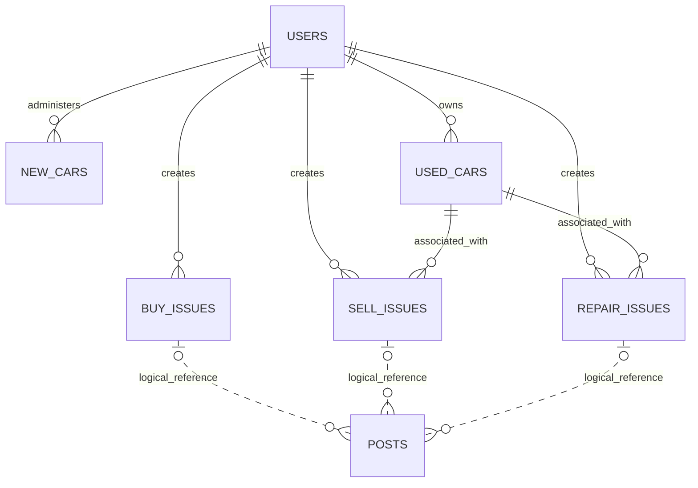

# Car Owner Hub — Database Design & Django REST Framework Architecture

**Status:** MVP design specification  
**Backend:** Django + Django REST Framework (DRF)  
**Database:** PostgreSQL  
**Application models:** Seven (`users`, `new_cars`, `used_cars`, `buy_issues`, `sell_issues`, `repair_issues`, `posts`)  
**Vehicle scope:** Any manufacturer; not Toyota-specific  
**Implementation:** Design only; no code

## 1. Overview

Car Owner Hub enables users to research buying, selling, and repairing cars. Users create an issue for their intent; an AI agent can analyze the request and prepare a proposed public post. A post remains a draft until its owner explicitly approves publication.

The system separates **new cars** and **used cars**:

- A **new car** is a first-hand catalog entry with an **admin account as `owner`**. This ownership represents platform catalog administration, not legal ownership of dealer stock or verified inventory.
- A **used car** is registered with the **authenticated user as `owner`**. Registration does not automatically publish or list the vehicle for sale.

There is no shared parent `issues` table. Buy, Sell, and Repair are independent models.

## 2. Data model and relationships



**Relationship conventions**

- One user may register multiple used cars and create multiple issues.
- New cars are administered by users with admin privileges.
- A Buy issue stores budget and preferences. It does not reference a specific new or used car.
- A Sell or Repair issue references one registered used car.
- A Post belongs logically to **exactly one** Buy, Sell, or Repair issue, identified by `issue_type` and `issue_id`.
- One issue may have zero or many drafts/posts under this MVP schema. A later requirement may enforce at most one published post per issue.

## 3. Table definitions

Types below are PostgreSQL-oriented. UUID keys are generated by the application; timestamp fields should be timezone-aware.

### 3.1 `users`

**Purpose:** Custom Django user model for authentication and permissions.

| Column | Type | Rules / Notes |
|---|---|---|
| `id` | UUID | Primary key |
| `name` | VARCHAR(100) | Required display name |
| `email` | VARCHAR(255) | Required, unique |
| `password` | VARCHAR(128) | Django-managed **hashed** password; never plaintext |
| `is_staff` | BOOLEAN | Default `false`; determines admin access together with permissions |
| `is_active` | BOOLEAN | Default `true` |
| `date_joined` | TIMESTAMPTZ | Creation timestamp |

**Django note:** Use a custom user model configured as `AUTH_USER_MODEL` from the beginning. Django's actual authentication implementation may require additional fields (for example `is_superuser`, groups and permissions) and additional framework-managed tables. Seven is the count of **logical application models**, not a promise of exactly seven physical database tables.

### 3.2 `new_cars`

**Purpose:** First-hand car catalog records administered by an admin.

| Column | Type | Rules / Notes |
|---|---|---|
| `id` | UUID | Primary key |
| `owner_id` | UUID | FK → `users.id`; required; owner must have appropriate admin permission |
| `make` | VARCHAR(100) | Required; any manufacturer |
| `model` | VARCHAR(100) | Required |
| `year` | INTEGER | Required |
| `trim` | VARCHAR(100) | Optional |
| `msrp` | NUMERIC(12,2) | Optional; nonnegative; reference price, not guaranteed dealership price |
| `created_at` | TIMESTAMPTZ | Creation timestamp |

**Important:** A new-car catalog entry must not be presented as confirmed in-stock dealer inventory without a separate verified source.

### 3.3 `used_cars`

**Purpose:** User-registered, previously owned cars.

| Column | Type | Rules / Notes |
|---|---|---|
| `id` | UUID | Primary key |
| `owner_id` | UUID | FK → `users.id`; required; assigned from authenticated user |
| `make` | VARCHAR(100) | Required; any manufacturer |
| `model` | VARCHAR(100) | Required |
| `year` | INTEGER | Required |
| `trim` | VARCHAR(100) | Optional |
| `mileage` | INTEGER | Required; nonnegative |
| `condition` | TEXT | Optional owner-reported summary |
| `created_at` | TIMESTAMPTZ | Creation timestamp |

**Privacy:** A privately registered used car is not automatically searchable publicly. Public used-car information must come from seller-approved published content.

### 3.4 `buy_issues`

**Purpose:** Records a user's purchase request and preferences.

| Column | Type | Rules / Notes |
|---|---|---|
| `id` | UUID | Primary key |
| `user_id` | UUID | FK → `users.id`; required |
| `description` | TEXT | Required; original user request |
| `min_budget` | NUMERIC(12,2) | Optional; nonnegative |
| `max_budget` | NUMERIC(12,2) | Optional; nonnegative; not less than `min_budget` if both present |
| `preferences` | JSONB | Optional; desired make/model, age, mileage, fuel type, location, etc. |
| `status` | VARCHAR(20) | Default `open`; validate allowed values |
| `created_at` | TIMESTAMPTZ | Creation timestamp |
| `updated_at` | TIMESTAMPTZ | Last modification timestamp |

**Invariant:** A Buy issue describes what the user wants to purchase. Desired make, model, year, mileage, and new-versus-used preference belong in `preferences`, not in a foreign key to a catalog row. Matching against catalog entries and published listings happens when the agent researches the request.

Example `preferences`:

```json
{
  "preferred_makes": ["Toyota", "Honda"],
  "preferred_models": ["Camry", "Civic"],
  "minimum_year": 2020,
  "maximum_mileage": 60000,
  "vehicle_type": "used",
  "fuel_type": "hybrid",
  "location": "Austin, TX"
}
```

### 3.5 `sell_issues`

**Purpose:** Records a request to sell a user-owned used car.

| Column | Type | Rules / Notes |
|---|---|---|
| `id` | UUID | Primary key |
| `user_id` | UUID | FK → `users.id`; required |
| `used_car_id` | UUID | FK → `used_cars.id`; required |
| `description` | TEXT | Required |
| `asking_price` | NUMERIC(12,2) | Optional; nonnegative; seller chooses final price |
| `condition_details` | JSONB | Optional; mechanical, exterior, interior, maintenance |
| `known_damage` | TEXT | Optional owner disclosure |
| `location` | VARCHAR(255) | Optional approximate selling area |
| `contact_info` | JSONB | Optional private contact preferences; only explicitly approved fields become public |
| `status` | VARCHAR(20) | Default `open`; validate allowed values |
| `created_at` | TIMESTAMPTZ | Creation timestamp |
| `updated_at` | TIMESTAMPTZ | Last modification timestamp |

**Invariant:** The issue's `user_id` must match the referenced used car's `owner_id`, checked server-side. Pricing research cannot fabricate comparables or guarantee a sale price.

Example `condition_details`:

```json
{
  "mechanical": "good",
  "exterior": "minor scratches",
  "interior": "excellent",
  "maintenance_history": "Regular oil changes"
}
```

### 3.6 `repair_issues`

**Purpose:** Stores user-reported vehicle problems, AI analysis, and reported repair outcomes.

| Column | Type | Rules / Notes |
|---|---|---|
| `id` | UUID | Primary key |
| `user_id` | UUID | FK → `users.id`; required |
| `used_car_id` | UUID | FK → `used_cars.id`; required |
| `description` | TEXT | Required original problem description |
| `symptoms` | JSONB | Optional agent-extracted symptoms; distinguish inferences from confirmed facts |
| `ai_analysis` | JSONB | Optional sourced analysis, possibilities, uncertainty |
| `status` | VARCHAR(20) | Default `open`; allowed `open`, `resolved`, `unresolved`, `unsure` |
| `resolution_details` | JSONB | Optional one-field record of mechanic-assisted or self-service repair |
| `resolved_at` | TIMESTAMPTZ | Optional; when user reports resolution |
| `created_at` | TIMESTAMPTZ | Creation timestamp |
| `updated_at` | TIMESTAMPTZ | Last modification timestamp |

**Invariant:** For the current MVP, the issue creator must own the associated used car. `resolution_details` is owner-reported, not independently verified. Dangerous symptoms must prompt appropriate safety guidance rather than confident diagnosis.

Example mechanic-assisted `resolution_details`:

```json
{
  "method": "mechanic",
  "mechanic_name": "ABC Auto",
  "location": "Austin, TX",
  "work_performed": "Brake repair",
  "cost": 250
}
```

Example self-serviced `resolution_details`:

```json
{
  "method": "self",
  "instructions": "Replaced worn brake pads",
  "parts_used": ["Brake pads"],
  "cost": 65
}
```

**Repair-to-post flow:** On resolution, the AI requests the method and details, prepares a draft from information the owner has provided, and publishes only after explicit approval. Self-service steps must be labeled as owner-reported and not independently validated.

### 3.7 `posts`

**Purpose:** AI-generated drafts and owner-approved public posts associated with any issue type.

| Column | Type | Rules / Notes |
|---|---|---|
| `id` | UUID | Primary key |
| `issue_id` | UUID | Required; logical reference to one specialized issue table |
| `issue_type` | VARCHAR(10) | Required; exactly one of `buy`, `sell`, `repair` |
| `title` | VARCHAR(255) | Required agent-generated or owner-edited title |
| `content` | TEXT | Required agent-generated or owner-edited body |
| `post_data` | JSONB | Optional approved public snapshot; e.g. vehicle details, asking price, disclosed repair details, media references and selected contact fields |
| `status` | VARCHAR(20) | Default `draft`; allowed `draft`, `approved`, `published`, `archived` |
| `approved_at` | TIMESTAMPTZ | Optional; set only on explicit owner approval |
| `created_at` | TIMESTAMPTZ | Creation timestamp |
| `updated_at` | TIMESTAMPTZ | Last modification timestamp |

**Polymorphic association:**

| `posts.issue_type` | Target issue table |
|---|---|
| `buy` | `buy_issues` |
| `sell` | `sell_issues` |
| `repair` | `repair_issues` |

PostgreSQL cannot use a **single standard foreign key** from `posts.issue_id` to three different tables. Therefore, `issue_id` and `issue_type` must be validated together in Django's service layer (or by custom database triggers). `issue_id` is **not** a database-level foreign key in this design. Deletion and post-owner authorization must account for that limitation.

**Publication rules:** Drafts remain private; the owner can review/edit and approve; only `published` records appear publicly. `post_data` stores a frozen snapshot of approved disclosures, so later private car/issue changes do not automatically change what buyers or readers see.

## 4. Suggested Django application layout

| App | Responsibility | Models |
|---|---|---|
| `accounts` | Custom user, registration, authentication, permissions | `User` |
| `vehicles` | New- and used-car profiles, admin ownership constraints | `NewCar`, `UsedCar` |
| `issues` | User intents, workflow and ownership checks | `BuyIssue`, `SellIssue`, `RepairIssue` |
| `posts` | Draft generation workflow, publication permissions, public browsing | `Post` |
| `ai` | One chat turn from the client event history; structured extraction into issue fields | No model. The client stores messages, tool calls, and tool responses |

### 4.1 Django ORM conventions

- Use Django model `ForeignKey` relations for owners and concrete issue-to-vehicle relations.
- Use Django `JSONField` backed by PostgreSQL JSONB for flexible JSON columns.
- Use `TextChoices` or equivalent validations for intent/status-like fields.
- Use `DecimalField` for monetary values and timezone-aware `DateTimeField` for timestamps.
- Configure the custom `User` model **before** the initial migration.
- Use `select_related`/`prefetch_related` for efficient authorized reads.
- Use migrations for structural changes and indexes for frequently filtered fields.
- Create/approve post records through transactions to avoid partially applied workflow changes.

### 4.2 DRF serializers

| Serializer | Responsibility |
|---|---|
| `RegisterSerializer` | Registration validation and hashed password creation |
| `UserSerializer` | Safe account profile output |
| `NewCarSerializer` | Admin catalog entries |
| `UsedCarSerializer` | User-owned car information |
| `BuyIssueSerializer` | Budget and preferences |
| `SellIssueSerializer` | Seller-owned vehicle, disclosure, pricing |
| `RepairIssueSerializer` | Symptoms, analysis, repair outcome |
| `PostSerializer` | Draft/public representations; sensitive fields hidden where appropriate |

Server-supplied properties such as owner, authenticated issue creator, publication authorization and `approved_at` should not be trusted as arbitrary client-input fields.

### 4.3 Proposed REST API

These are planned endpoints; not claims about already implemented routes.

**Authentication**

| Method | Endpoint | Purpose |
|---|---|---|
| POST | `/api/auth/register/` | Create an account |
| POST | `/api/auth/login/` | Obtain JWT tokens |
| POST | `/api/auth/refresh/` | Refresh access token |
| GET | `/api/auth/me/` | Get authenticated profile |

**Vehicles**

| Method | Endpoint | Purpose |
|---|---|---|
| GET | `/api/cars/new/` | Browse published catalog entries |
| POST | `/api/cars/new/` | Admin-only create |
| GET | `/api/cars/used/` | Browse only permitted/public used cars or own cars, according to caller and filters |
| POST | `/api/cars/used/` | Register own used car |
| PATCH | `/api/cars/used/{id}/` | Edit owned used car |

**Issues**

| Method | Endpoint | Purpose |
|---|---|---|
| GET, POST | `/api/issues/buy/` | List own and create Buy requests |
| GET, POST | `/api/issues/sell/` | List own and create Sell requests |
| GET, POST | `/api/issues/repair/` | List own and create Repair requests |
| GET, PATCH | `/api/issues/buy/{id}/` | View/edit own Buy issue |
| GET, PATCH | `/api/issues/sell/{id}/` | View/edit own Sell issue |
| GET, PATCH | `/api/issues/repair/{id}/` | View/edit own Repair issue |
| PATCH | `/api/issues/repair/{id}/resolution/` | Record confirmed repair outcome |

**Posts**

| Method | Endpoint | Purpose |
|---|---|---|
| GET | `/api/posts/` | Browse public `published` posts only |
| GET | `/api/posts/{id}/` | Read public post or own draft |
| POST | `/api/posts/generate/` | Generate draft for authorized issue |
| PATCH | `/api/posts/{id}/` | Owner edits draft |
| POST | `/api/posts/{id}/approve/` | Owner approves and publishes verified snapshot |
| DELETE | `/api/posts/{id}/` | Owner deletes/archives post according to retention policy |

### 4.4 Permissions and enforcement

| Operation | Regular user | Admin |
|---|---|---|
| Create/edit own used car | Yes | Yes, subject to ownership rules |
| Create new-car catalog entry | No | Yes |
| Create own Buy issue | Yes | Yes |
| Create own Sell/Repair issue for owned used car | Yes | Yes |
| Read another user's private issue | No | Only if specifically authorized for admin duties |
| Generate draft from own issue | Yes | Yes |
| Publish draft associated with own issue | Yes | Yes |
| Moderate public posts | No | Yes |

**Backend checks:**

1. Derive `owner_id` and `user_id` from the authenticated identity where appropriate.
2. Verify that a referenced Sell/Repair used car belongs to the issue author.
3. Validate Buy-issue budget and preferences; do not require a specific vehicle.
4. Verify `posts.issue_type` is valid, `posts.issue_id` exists in the selected issue table, and the caller owns that issue.
5. Prevent draft or unpublished content from appearing in public search or AI cross-user retrieval.
6. Require explicit approval for each public disclosure, including repair history and seller contact details.
7. Choose explicit handling for deletion of a referenced issue; never leave invisible orphaned logical references by accident.
8. Apply model and serializer validation for sensible years, nonnegative monetary values and mileage, allowed statuses, and JSON shapes.

## 5. Key user journeys

### 5.1 Repair

1. User registers a car under `used_cars`.
2. User creates a `repair_issues` record associated with that car.
3. Agent analyzes symptoms and returns uncertain, sourced guidance.
4. User reports whether the issue was resolved.
5. If resolved, agent requests mechanic details or self-service explanation and saves them to `resolution_details`.
6. Agent generates a private `posts` draft with `issue_type = repair` and the matching `issue_id`.
7. User reviews and explicitly approves publication; otherwise the post stays private.

### 5.2 Sell

1. User selects their existing `used_cars` record.
2. User creates `sell_issues` with pricing preference, condition and disclosures.
3. Agent researches comparable listings where source evidence is available and prepares a draft listing.
4. Seller reviews price, disclosure and external contact fields.
5. Approval publishes a `posts` record with `issue_type = sell` and a seller-approved public snapshot.

### 5.3 Buy

1. User creates `buy_issues` with a description, budget, and preferences.
2. Agent evaluates eligible catalog records, published sale posts and external sources as available.
3. User sees suggestions with evidence and limitations.
4. Any optional Buy post also follows the draft-and-approval rule; creating a Buy issue does not require a post.

## 6. Design limitations and future considerations

- **Polymorphic posts:** One `issue_id` plus `issue_type` is simpler at the API level but sacrifices normal cross-table foreign-key enforcement. A later shared issue table could restore database-level referential integrity if complexity increases.
- **New vs. used:** Separate vehicle tables duplicate shared fields (`make`, `model`, `year`, `trim`) intentionally to match current requirements. Vehicle transitions or shared references may need additional business logic later.
- **Admin-owned new cars:** `owner` means the admin/catalog account; it does **not** assert ownership of manufacturer inventory.
- **Repair scope:** The current design requires a `used_car_id` for a Repair issue, so users must register the vehicle before creating its repair issue. Make this relation optional or introduce an alternative workflow if anonymous/unregistered vehicle troubleshooting is required.
- **Conversation history:** The frontend stores the transcript as an ordered event list: user messages, Agent 1 messages, tool calls, and tool responses. Each turn posts that list and appends the new events the backend returns. PostgreSQL does not store the list. Issue descriptions, symptoms, analysis, and resolution remain on the issue rows, so a cleared client history can still resume the case.
- **No payments/transactions:** Buyer and seller communication, service bookings, payments and vehicle purchases occur outside the app.
- **Public vs. private:** Do not directly expose all `used_cars`, private issues, raw agent conversations or private contacts to public searches. Public listing data should be constructed from approved posts.

---

**Final design decision:** Seven logical application tables; no common issue parent; two car tables with an `owner` field; three separate issue tables; and one shared posts table using `issue_id` + `issue_type`, with ownership/relationship integrity checked by Django and public publication gated by user approval.
