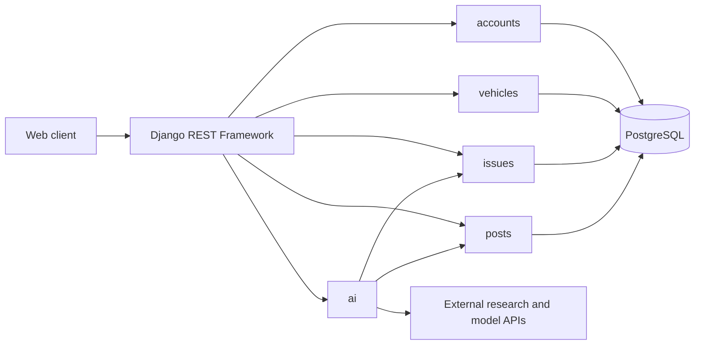
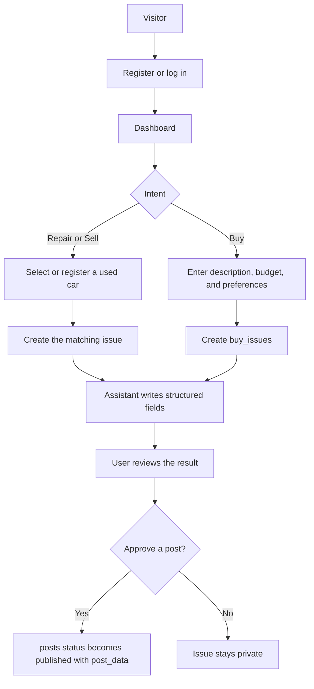

# Car Owner Hub — System Architecture Design

**Status:** MVP architecture specification  
**Related design:** [car_owner_hub_database_design.md](car_owner_hub_database_design.md) is the source of truth for tables, columns, and invariants  
**Backend:** Django + Django REST Framework  
**Database:** PostgreSQL  
**Implementation:** Design only; no application code

This document carries the product behavior from the original project brief and fits it to the current data model. The brief described a Toyota-only app on FastAPI and Supabase, with one `queries` table and separate case and listing tables. The current system is **Car Owner Hub**: any manufacturer, Django and PostgreSQL, and seven logical models (`users`, `new_cars`, `used_cars`, `buy_issues`, `sell_issues`, `repair_issues`, `posts`).

Column definitions, foreign keys, and publication invariants stay in the database design. This document describes how the application is structured around them.

## 1. Product scope

Car Owner Hub helps people repair, sell, or buy a car using an AI assistant, published owner experiences, and public web information.

A signed-in user creates an **issue** for one intent:

1. **Repair** — describe a problem on a car they registered, review sourced possibilities and other owners' published experiences, then record an outcome. Sharing that outcome is a separate, explicit approval.
2. **Sell** — describe a registered used car, review an evidence-based asking-price range when real comparables exist, and publish a listing with only the contact fields the seller approves.
3. **Buy** — record a budget and preferences. The assistant matches those preferences to the new-car catalog, published sale posts, and external sources. The buy issue does not point at one specific car.

**Repair is the primary path.** Sell and buy reuse the same accounts, used-car records, assistant, and draft-then-approve publication flow.

The connecting idea is that a vehicle's reported issue and repair outcome can later inform resale disclosure and buyer research. The assistant interprets and retrieves information. It does not guarantee a diagnosis, a sale price, or a vehicle's condition.

### Actors

| Actor | Needs | Main actions |
|---|---|---|
| Owner with a problem | Understand possible causes, urgency, and options | Register a used car, create a repair issue, compare published experiences, record an outcome |
| Owner with an outcome worth sharing | Publish what happened without private details | Approve a repair post; leave it private otherwise |
| Seller | Present condition and price honestly | Create a sell issue for an owned used car, set the asking price, approve a public snapshot |
| Buyer | Compare options against a budget | Create a buy issue, read published sale posts and catalog entries, contact sellers outside the app |
| Administrator | Maintain the new-car catalog and moderate public posts | Create `new_cars` rows; moderate published posts when that duty is authorized |

## 2. System shape

| Layer | Choice | Responsibility |
|---|---|---|
| Client | React, TypeScript, Vite, Tailwind CSS | Dashboard, issue forms, draft review, public browsing |
| API | Django + Django REST Framework | Authentication, validation, ownership checks, JSON contracts |
| Persistence | PostgreSQL | The seven logical models and Django's auth tables |
| Assistant | `ai` Django app, no MVP model | Intake structuring, research, draft generation |

Authentication uses the custom `users` model from the start (`AUTH_USER_MODEL`) and JWT access and refresh tokens. Passwords are Django-managed hashes. `is_staff` participates in admin permission for catalog creation and moderation. It does not by itself grant reading every private issue.

Proposed external services, called only from the server:

- A model API (Gemini in the original brief) for structured extraction, explanation, and optional image or voice intake after credentials and quotas are confirmed.
- A web-search API (SerpApi in the original brief) for repair research and comparable asking prices. Store source links and retrieval context with the analysis or the draft, not in a separate research table.
- A places or local-business search for nearby mechanics, used only with a city, ZIP, or other location the user supplied.

If a provider times out or returns nothing, the issue still persists and the response says what could not be retrieved.

## 3. Django applications

| App | Owns | Does not own |
|---|---|---|
| `accounts` | `User`, registration, login, refresh, `/api/auth/me/` | Vehicle or issue records |
| `vehicles` | `NewCar`, `UsedCar`, admin-only catalog writes, owner-only used-car edits | Public listing text; that lives on an approved post |
| `issues` | `BuyIssue`, `SellIssue`, `RepairIssue`, ownership checks, repair resolution | Publication; creating an issue does not create a public post |
| `posts` | `Post` drafts, owner edits, approval, public browse, archive or delete | Cross-table foreign keys; `issue_id` plus `issue_type` is checked in the service layer |
| `ai` | Symptom extraction, sourced analysis, comparable-price research, draft preparation | Its own database table in the MVP; it writes into issue JSON fields and `posts` |

Serializers accept client fields for the user's request. The server sets `user_id`, `owner_id`, and `approved_at` from the authenticated user and the approval action.

## 4. How product concepts map onto the schema

There is no shared `issues` or `queries` parent. Buy, sell, and repair are separate tables because their required data differs.

| Product idea | Where it lives |
|---|---|
| Account | `users` |
| A car the user owns | `used_cars`, with `owner_id` taken from the authenticated user |
| A first-hand catalog entry | `new_cars`, owned by an admin account; reference MSRP only, not verified dealer stock |
| A purchase request | `buy_issues`: `description`, `min_budget`, `max_budget`, `preferences` |
| A sale request | `sell_issues` for one owned `used_cars` row: asking price, condition, damage, location, private `contact_info` |
| A repair request | `repair_issues` for one owned `used_cars` row: `description`, `symptoms`, `ai_analysis`, `resolution_details` |
| Anything the public can read | `posts` with `status = published` and a frozen `post_data` snapshot |

Earlier brief tables that this architecture does **not** add for the MVP: `queries`, `repair_cases`, `case_comments`, `sale_listings`, `buyer_preferences`, `saved_items`, and `research_sources`.

Consequences:

- A buy issue never stores `new_car_id` or `used_car_id`. Desired make, model, year, mileage, fuel type, location, and new-versus-used preference are JSON on `preferences`. Matching happens when the assistant runs.
- Sell and repair require `used_car_id`, and that car's `owner_id` must equal the issue's `user_id`.
- Private history stays on the issue. Public repair stories and sale listings are posts. `post_data` is the approved snapshot, so a later edit to the used car or the issue does not silently change what readers already see.
- One issue may have zero posts or several drafts. Only `published` posts appear in public browse and in cross-user retrieval.
- The MVP keeps the latest structured analysis on the repair issue. It does not store a full chat transcript.
- Saved items and comments are out of the MVP schema. Add them only after the publication boundary is working.

## 5. Runtime flows

Repair and sell start from a used car the caller owns. Buy starts from budget and preferences alone. Opening a sell or buy issue does not convert a repair issue into a listing. The user can reuse the same `used_cars` row later and choose what to disclose.

### 5.1 Repair

1. The user registers the car on `used_cars` (make, model, year, mileage, optional trim and condition).
2. The user creates `repair_issues` with the original `description`. The API rejects a car the caller does not own.
3. The `ai` app writes `symptoms` as structured observations, keeping owner-stated facts distinct from inferences. It writes `ai_analysis` as sourced possibilities, uncertainty, and safety guidance. Neither field is a confirmed fault.
4. The response can include published repair posts for similar vehicles and external results with URLs and retrieval context. Labels stay visible: official information, community-reported experience, or other public resource.
5. Self-help content is sourced and plain-language. Hazardous situations get a limitation and a prompt toward qualified help, not a procedure the design has ruled out.
6. Mechanic discovery, when implemented, uses a location the user provided and returns real businesses. The app does not book appointments.
7. The user sets `status` to `resolved`, `unresolved`, or `unsure`. A resolution stores one `resolution_details` object, either mechanic-assisted or self-service, plus `resolved_at` when they report it fixed. That record is owner-reported.
8. If the user wants to share the outcome, the assistant creates a private post with `issue_type = repair`. Approval sets `approved_at`, `status = published`, and a `post_data` snapshot of the fields the owner agreed to show.

A public repair post may show vehicle context, symptoms, reported action, optional cost, and the label that the fix is owner-reported.

### 5.2 Sell

1. The user selects an existing `used_cars` row they own.
2. The user creates `sell_issues` with description, optional `asking_price`, `condition_details`, `known_damage`, approximate `location`, and private `contact_info`.
3. The assistant may retrieve current comparable asking-price listings and explain the range, the sources, and the gaps. Sparse data produces an insufficient-data result. The assistant does not invent a price or apply an automatic penalty per past repair.
4. The seller chooses the asking price and reviews which condition, history, and contact fields are public.
5. Approval publishes `issue_type = sell` with those fields frozen in `post_data`.

Buyers reach the seller through the approved external contact method. There is no in-app checkout, escrow, negotiation chat, or payment.

### 5.3 Buy

1. The user creates `buy_issues` with a description, optional `min_budget` and `max_budget`, and `preferences`.
2. The assistant compares that request with admin `new_cars` catalog rows, published sell posts, and external sources that are actually available.
3. Recommendations state which preference each option meets and where information is missing. Catalog MSRP is a reference price. A catalog row is not a claim that a dealer has the car in stock.
4. A buy post is optional and follows the same draft and approval rule. Creating the issue does not publish anything.

Contact with a seller happens outside the app, using the contact fields on that seller's published post.

## 6. Assistant boundaries

The assistant identifies the issue type from the endpoint the user called, asks only for missing fields that endpoint requires, and writes structured JSON the matching serializer accepts.

On repair issues the two JSON fields stay separate:

- `symptoms` records what the car is doing.
- `ai_analysis` records what those signs might mean, with sources and uncertainty.

Sell and buy do not have those columns. Their assistant output is shown to the user and, if they approve publication, copied into the draft post.

Rules that the API and the `ai` app both enforce:

1. Possible mechanical explanations stay qualified and sourced. An image, a noise description, or a written symptom is not a diagnosis.
2. Dangerous symptoms, including brake or steering failure, smoke, fire, and severe fuel leaks, produce urgent-help guidance.
3. Mechanics, reviews, recall applicability, comparables, prices, inventory, and owner experiences come from retrieved data or from an approved post. Missing data stays missing.
4. Issues, raw assistant output, `contact_info`, and registered used cars are private. Cross-user retrieval may use published posts, licensed public material, and the admin catalog.
5. Saving an issue so the same user can resume is allowed. Using private issues to fine-tune a shared model is outside this system.
6. A price range is indicative. The seller sets `asking_price`.
7. Purchases, bookings, and payments stay outside the app.
8. Third-party pages are linked and attributed. They are not copied in as if those authors joined the platform.
9. Buyer-facing explanations are research, not a vehicle inspection.

## 7. HTTP API

These routes are the planned contract. They are not implemented.

**Authentication**

| Method | Endpoint | Purpose |
|---|---|---|
| POST | `/api/auth/register/` | Create an account |
| POST | `/api/auth/login/` | Obtain JWT tokens |
| POST | `/api/auth/refresh/` | Refresh an access token |
| GET | `/api/auth/me/` | Read the authenticated profile |

**Vehicles**

| Method | Endpoint | Purpose |
|---|---|---|
| GET | `/api/cars/new/` | Browse catalog entries |
| POST | `/api/cars/new/` | Admin-only catalog create |
| GET | `/api/cars/used/` | List the caller's cars; public callers do not receive private registrations |
| POST | `/api/cars/used/` | Register a used car for the authenticated user |
| PATCH | `/api/cars/used/{id}/` | Edit a used car the caller owns |

**Issues**

| Method | Endpoint | Purpose |
|---|---|---|
| GET, POST | `/api/issues/buy/` | List and create the caller's buy issues |
| GET, POST | `/api/issues/sell/` | List and create the caller's sell issues |
| GET, POST | `/api/issues/repair/` | List and create the caller's repair issues |
| GET, PATCH | `/api/issues/buy/{id}/` | Read or edit one own buy issue |
| GET, PATCH | `/api/issues/sell/{id}/` | Read or edit one own sell issue |
| GET, PATCH | `/api/issues/repair/{id}/` | Read or edit one own repair issue |
| PATCH | `/api/issues/repair/{id}/resolution/` | Record `resolution_details`, status, and `resolved_at` |

**Posts**

| Method | Endpoint | Purpose |
|---|---|---|
| GET | `/api/posts/` | Browse `published` posts; filter by `issue_type` for repair stories or sale listings |
| GET | `/api/posts/{id}/` | Read a published post, or the owner's own draft |
| POST | `/api/posts/generate/` | Create a draft for an issue the caller owns |
| PATCH | `/api/posts/{id}/` | Owner edits a draft |
| POST | `/api/posts/{id}/approve/` | Owner approves and freezes `post_data` |
| DELETE | `/api/posts/{id}/` | Owner archives or deletes according to the retention rule |

Server-side checks on every write:

1. Set owner and author ids from the authenticated user.
2. For sell and repair, require `used_car.owner_id == issue.user_id`.
3. For buy, validate budget order and the preferences shape, and do not require a vehicle id.
4. For a post, require a known `issue_type`, an existing row in that issue table, and a caller who owns that issue.
5. Exclude drafts and unpublished issues from public list endpoints and from assistant retrieval for other users.
6. Copy contact fields and repair history into `post_data` only from the approval payload.
7. Define what happens to posts when an issue is deleted so logical references are not left implicit.
8. Reject impossible years, negative money, negative mileage, unknown statuses, and unexpected JSON shapes.

`posts.issue_id` is not a database foreign key, because it can refer to any of the three issue tables. Django validates the pair in a transaction that also writes `approved_at` and `post_data` on approval.

## 8. Client surfaces

The client is a thin caller of the API above.

- Auth screens call register, login, refresh, and me.
- The dashboard lists the caller's used cars and the three issue collections.
- Repair, sell, and buy forms post to the matching issue collection. Repair and sell forms select a `used_cars` id first.
- The repair detail screen shows `description`, `symptoms`, and `ai_analysis` separately, then the resolution action.
- The sell detail screen shows research, the seller-chosen price, and a preview of the public snapshot before approve.
- The buy detail screen shows catalog matches and published sell posts against `preferences` and budget. It does not ask the user to attach a car id.
- Public pages call `GET /api/posts/` and render `post_data` for published rows only.

Browsing published posts can be anonymous. Creating a car, an issue, or a post requires a session.

## 9. MVP boundaries

Build in this order. Each step should work against the real API and database before the next one starts.

**P0**

1. Custom user, JWT auth, and a dashboard that can open all three issue types.
2. Used-car registration and owner checks.
3. Repair: create the issue, persist `symptoms` and `ai_analysis` from a real model call, run a real external search, and show published repair posts as related experience.
4. Resolution statuses `resolved`, `unresolved`, and `unsure`, then an explicit draft and approve step.
5. Sell: condition, seller-chosen asking price, approved contact snapshot, published post.
6. Buy: create budget and preferences, and browse published sell posts with working filters.
7. Safety copy, source links, and a usable response when an external API fails.

**P1, after that slice works**

1. Comparable asking-price research that can return insufficient data.
2. Nearby mechanic lookup from a user-supplied location.
3. Image or voice intake into the same repair issue fields.
4. Buy recommendations that cite which preference each catalog row or published post satisfies.
5. A sell draft that can offer selected fields from the owned car and from the owner's own repair issues, still reviewed before approval.

**P2, only with time left**

- Comments on published posts.
- A confirmed Meta voice integration.
- Richer new-car catalog browsing with sourced manufacturer links.
- Embeddings, maps, and a moderation queue beyond the admin post actions already in the permission table.

**Outside this system**

- A general social feed or reputation graph.
- Mechanic scheduling.
- In-app buyer and seller chat, checkout, escrow, or money movement.
- Automated VIN verification or a guaranteed history report.
- Loan approvals or personalized financing offers.
- Publishing repair history without an approved post.
- Fine-tuning on private issues.
- A single `queries` table, a separate listings table, or foreign keys from `buy_issues` to cars.

An optional **Ownership Next Step** panel can sit on the issue screens without new tables: repair compares the owner's reported cost and status, sell explains the sourced range and unanswered disclosure, and buy compares published asking prices with `min_budget` and `max_budget`. The original event framing asked what the smartest next move is for a Toyota owner, including payments and trade-offs. This architecture can demo that story with Toyota vehicles in the data. The schema itself accepts any make, and repair guidance alone is not a financial-services product.

## 10. Demo and completion

**Repair.** A user registers a used car, opens a repair issue, sees a real model response and a real search with labeled public posts, records fixed, not fixed, or unsure, and either approves a post or leaves the issue private.

**Sell.** The same user opens a sell issue on that car, reviews a sourced range when the search returned comparables, sets an asking price, and approves a snapshot that includes only the contact fields they chose.

**Buy.** A second user opens a buy issue with a budget and preferences, finds that published sell post through filters, and uses the external contact. The app does not complete a purchase.

The MVP is complete when:

- A new user can authenticate and open a repair, sell, or buy issue.
- A repair issue is still there after refresh, with symptoms and analysis stored separately.
- Research links come from a live call.
- Published posts are searchable and private issues are not.
- Repair resolution supports resolved, unresolved, and unsure.
- Publication happens only through post approval.
- A seller can publish a post whose `post_data` contains the approved contact method.
- A buyer can filter to that post.
- Price research reports insufficient data instead of inventing comparables.
- Dangerous repair text returns safety guidance.
- External API failure leaves the app usable.
- Seeded examples are labeled synthetic.

## 11. Build order

| Role | Primary ownership |
|---|---|
| Client | Auth, dashboard, three issue flows, draft review |
| Repair and assistant | `ai` app, `symptoms`, `ai_analysis`, safe synthesis |
| Research | Search adapter, source links, pricing research, mechanic lookup if P0 is done |
| API and data | Django project, the seven models, permissions, post transactions |
| Integration | Contract checks, deployment, the demo path |

1. Confirm provider credentials and freeze the JSON shapes for preferences, symptoms, analysis, condition, contact, and `post_data`.
2. Create the custom user and the other models before feature work, matching the database design.
3. Finish text-only repair, including approval, before image or voice.
4. Add the minimal sell post and buy browse.
5. Add mechanic lookup, sourced pricing, and richer catalog matching only after that path is reliable.

Secrets stay in untracked environment variables. Seed data that is not a real owner is labeled synthetic.
