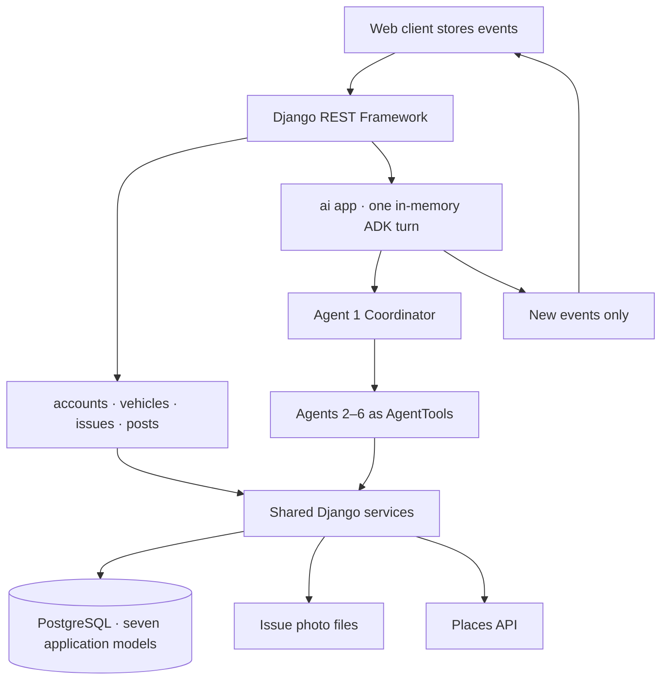
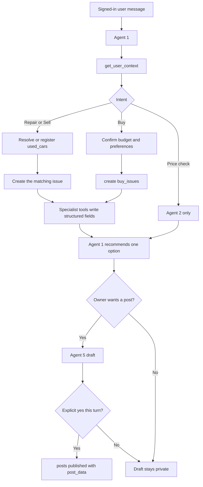

# Car Owner Hub — System Architecture Design

**Status:** MVP architecture specification  
**Related designs:**

- [car_owner_hub_agent_architecture.md](car_owner_hub_agent_architecture.md) is the source of truth for the six agents, their tools, the client event history, and orchestration
- [car_owner_hub_database_design.md](car_owner_hub_database_design.md) is the source of truth for tables, columns, and invariants

**Backend:** Django + Django REST Framework  
**Agents:** Google ADK, six agents, one voice  
**Database:** PostgreSQL  
**Implementation:** Design only; no application code

This document describes how the product is structured around the seven application models and the six-agent design. Column definitions stay in the database design. Tool contracts, output shapes, and specialist workflows stay in the agent architecture.

## 1. Product scope

Car Owner Hub helps people repair, sell, or buy a car through one conversation. Google ADK runs six agents. Agent 1, the coordinator, is the only agent that replies to the user. It delegates to five specialists: Vehicle Valuation, Buyer Recommendation, Seller Recommendation, Community Post Generation, and Repair & Mechanic Recommendation. Specialists return results to Agent 1. They never speak to the user and never call each other.

A signed-in user talks to Agent 1. The same Django services back the chat and the forms, so a form write and a tool write follow one permission path.

Each user intent becomes an issue, except a price check, which does not:

1. **Repair** — describe a problem on a car they registered. Agent 6 records symptoms and analysis, compares published repair posts, estimates owner-reported cost when enough posts exist, and can look up mechanics. Sharing the outcome is a separate approval through Agent 5.
2. **Sell** — describe a registered used car. Agent 1 runs Agent 2, then Agent 4, then Agent 5: an asking-price range from published sell posts and catalog MSRP, a seller-chosen price, matching published buy posts, and a listing draft. Publication includes only the contact fields the seller approves.
3. **Buy** — record a budget and preferences. Agent 3 matches published sell posts and, when the request includes new cars, the `new_cars` catalog. The buy issue does not point at one specific car. A public buy post is optional and goes through Agent 5.
4. **Price check** — Agent 2 only. No issue row.
5. **Share an outcome or request** — Agent 5 drafts a post on an issue that already exists.

**Repair is the primary path.** Sell and buy reuse the same accounts, used-car records, coordinator, and draft-then-approve publication flow.

The connecting idea is that a reported repair can later inform resale disclosure and buyer research. Agent 1 can set owner-reported repair cost against an asking-price range and recommend one next step. The assistant does not guarantee a diagnosis, a sale price, or a vehicle's condition. It does not offer loans or move money.

### Actors

| Actor | Needs | Main actions |
|---|---|---|
| Owner with a problem | Understand possible causes, urgency, and options | Tell Agent 1 about a registered car; Agent 6 opens the repair issue |
| Owner with an outcome worth sharing | Publish what happened without private details | Approve the Agent 5 draft; leave it private otherwise |
| Seller | Present condition and price honestly | Open a sell issue on an owned car, accept or change the recommended price, approve a public snapshot |
| Buyer | Compare options against a budget | Open a buy issue, read ranked sell posts and catalog entries, contact sellers outside the app |
| Administrator | Maintain the new-car catalog and moderate public posts | Create `new_cars` rows; moderate published posts when that duty is authorized |

## 2. System shape

The client holds the conversation. Each request sends the full `events` list, ending with the new user message. The backend runs Agent 1 for that request, appends assistant messages, tool calls, and tool responses, and returns only the new events. The client appends them. The next user message is appended on the client, and the loop repeats. There is no conversations table and no ADK `DatabaseSessionService`.

Inside one request, Agent 1 still chains specialists through in-memory state. A sell turn runs Agent 2, then Agent 4, then Agent 5. A repair turn runs Agent 6, and Agent 5 only when the owner wants a post. Valuation math runs once in `valuation_service.estimate()`. Agent 4 reads `state["valuation"]` for this request. The valuation `tool_response` is what the client keeps, so a later turn can rehydrate that state instead of pricing the car again.

| Layer | Choice | Responsibility |
|---|---|---|
| Client | React, TypeScript, Vite, Tailwind CSS | Store `events`, render messages, dashboard, issue forms, draft review, public browsing |
| API | Django + Django REST Framework | JWT authentication, validation, ownership checks, JSON contracts, one chat turn |
| Agents | Google ADK in the `ai` app, in memory for one request | Intent, delegation, explanation. Agents choose tools; they do not run SQL |
| Persistence | PostgreSQL | The seven application models and Django auth tables. No chat transcript |
| Photos | Backend media directory | One copy per upload, named from the issue primary key; posts reference that copy |
| Evidence | Published posts and `new_cars` | Asking prices, repair anecdotes, and catalog MSRP. No separate research table |

Authentication uses the custom `users` model from the start (`AUTH_USER_MODEL`) and JWT access and refresh tokens. Passwords are Django-managed hashes. Each chat turn authenticates the JWT and sets `state["user_id"]` on an in-memory session. Tools read `tool_context.state["user_id"]`. No tool accepts `user_id`, `owner_id`, or `buyer_id` as a model argument, and the client history cannot set them. `is_staff` participates in admin permission for catalog creation and moderation. It does not by itself grant reading every private issue.

The event list is the context. Its shape is defined in the agent architecture. Summary:

| `kind` | Stored by | Shown in the chat |
|---|---|---|
| `message` with `role: user` | Frontend, before the request | Yes |
| `message` with `role: assistant` | Backend, Agent 1 only | Yes |
| `tool_call` | Backend | No. Kept so the next turn has the call |
| `tool_response` | Backend | No. Kept so the next turn has the result |

In-request state, discarded with the session after the response:

| Key | Set by | Holds |
|---|---|---|
| `user_id` | Server, from the JWT, every turn | Authenticated user |
| `active_used_car_id` | Agent 1 this turn, or the latest tool response in the submitted history | Car resolved for this conversation |
| `active_issue` | Agent 1 this turn, or the latest tool response | `{type, id}` of the open buy, sell, or repair issue |
| `draft_post_id` | Agent 5 this turn, or the latest tool response | Post waiting for approval |
| `valuation` | `valuation_service` this turn, or the latest valuation tool response | Range Agent 4 reads |
| `last_search_results` | Search tools this turn, or the latest search tool response | Latest ranked post or catalog ids |

Durable facts go to the issue, not the chat: symptoms, `ai_analysis`, and `resolution_details` on `repair_issues`; condition on `sell_issues`; budget and preferences on `buy_issues`. Clearing the client event list drops the wording and the tool trace. The issue rows are still there.

External calls, from the server only:

- Google ADK for the six agents. Model credentials and quotas stay in environment variables.
- A places or local-business search, used by Agent 6 only with a city, ZIP, or other location the user supplied. Published repair posts can also name a mechanic the owner already agreed to show.

If the places provider times out or returns nothing, the repair issue still persists and Agent 1 says mechanic lookup was unavailable. Valuation and repair-cost tools do not call the web. They read published posts and, for valuation, `new_cars.msrp`. Thin samples return `insufficient_data`.

## 3. Django applications

| App | Owns | Does not own |
|---|---|---|
| `accounts` | `User`, registration, login, refresh, `/api/auth/me/` | Vehicle or issue records |
| `vehicles` | `NewCar`, `UsedCar`, admin-only catalog writes, owner-only used-car edits | Public listing text; that lives on an approved post |
| `issues` | `BuyIssue`, `SellIssue`, `RepairIssue`, ownership checks, repair resolution, issue photo files | Publication; creating an issue does not create a public post |
| `posts` | `Post` drafts, owner edits, approval, public browse, archive on issue delete | Its own photo files, and a database foreign key for `issue_id`; the service layer checks `issue_id` plus `issue_type`, and the post stores a path to the issue photo |
| `ai` | ADK runner for one turn, Agent 1, Agents 2–6 wrapped as `AgentTool`s, `POST /api/chat/turns/` | Application tables and the event list. Tools call domain services in-process. The response is the new events only |

Shared services, called by DRF views and by ADK function tools:

| Service | Used by | Behavior |
|---|---|---|
| Domain issue, car, and post services | Forms and the matching agent tools | The writes already planned on the REST API |
| `post_search_service` | Agents 2, 3, 4, and 6 | SQL filters on published `posts` and `post_data`, then ranking. Hard filters run before `LIMIT` |
| `valuation_service.estimate()` | Agent 2, then Agent 4 via in-request state | Deterministic range from comparable asking prices and catalog MSRP. The client keeps the tool response |
| `places_client` | Agent 6 | External mechanic search. Not stored as an application model |

Serializers accept client fields for the user's request. The server sets `user_id`, `owner_id`, and `approved_at` from the authenticated user and the approval action. Agent tools use those same services, so a chat write cannot bypass a form check.

## 4. How product concepts map onto the schema

There is no shared `issues` or `queries` parent. Buy, sell, and repair are separate tables because their required data differs. Chat history is not an eighth model. The client stores it.

| Product idea | Where it lives |
|---|---|
| Account | `users` |
| Working memory for one chat | Client `events`: user messages, Agent 1 messages, tool calls, tool responses |
| A car the user owns | `used_cars`, with `owner_id` taken from the authenticated user |
| A first-hand catalog entry | `new_cars`, owned by an admin account; reference MSRP only, not verified dealer stock |
| A purchase request | `buy_issues`: `description`, `min_budget`, `max_budget`, `preferences` |
| A sale request | `sell_issues` for one owned `used_cars` row: asking price, condition, damage, location, private `contact_info` |
| A repair request | `repair_issues` for one owned `used_cars` row: `description`, `symptoms`, `ai_analysis`, `resolution_details` |
| A price check | No issue row. The valuation `tool_response` stays in the client history |
| Anything the public can read | `posts` with `status = published` and a frozen `post_data` snapshot |
| A photo on an issue or its posts | One file under `media/issues/{issue_type}/{issue_id}/`, referenced by `post_data.photos` |
| Marketplace inventory | Published sell posts. `used_cars` stay private |
| Buyer discovery | Published buy posts. Private `buy_issues` are never searched across users |
| Seller or buyer contact | Only fields the owner approved into `post_data.contact` |
| Valuation evidence | Asking prices on published sell posts, plus `new_cars.msrp`, labelled as asking or reference prices |
| Repair cost evidence | Owner-reported `cost` on published repair posts, labelled anecdotal |

Earlier brief tables that this architecture does not add for the MVP: `queries`, `repair_cases`, `case_comments`, `sale_listings`, `buyer_preferences`, `saved_items`, and `research_sources`. General `discussion` posts are not a post type. The current `issue_type` values are `buy`, `sell`, and `repair`.

Consequences:

- A buy issue never stores `new_car_id` or `used_car_id`. Desired make, model, year, mileage, fuel type, location, and new-versus-used preference are JSON on `preferences`. Agent 3 matches when the buyer asks.
- `buy_issues` has no `contact_info`. Buyer contact is captured when the owner approves a buy post.
- Sell and repair require `used_car_id`, and that car's `owner_id` must equal the issue's `user_id`. Agent 1 registers the car before either issue exists.
- Private history stays on the issue. Public repair stories and sale listings are posts. `post_data` is the approved snapshot, so a later edit to the used car or the issue does not silently change what readers already see.
- One issue may have zero posts or several drafts. Only `published` posts appear in public browse and in cross-user retrieval.
- The latest structured analysis stays on the repair issue. The chat transcript stays in the client event list, not in PostgreSQL.
- Saved items and comments are out of the MVP schema. Add them only after the publication boundary is working.
- Deleting an issue archives its posts (`status = archived`) in the same transaction.

### 4.1 Issue photos

Photos belong to the issue. The backend stores the file once, and every post for that issue uses the same file. Agents do not invent photo paths. Agent 5 may list a path in `post_data.photos` only when the owner selected that file.

The `issues` app writes uploads under the backend media directory. The folder and the filename are taken from that issue's primary key. The issue type is part of the path so a buy, sell, and repair row never share a folder:

`media/issues/{issue_type}/{issue_id}/{issue_id}_{n}.{ext}`

`{issue_type}` is `buy`, `sell`, or `repair`. `{issue_id}` is that row's UUID. `{n}` is a sequence the server assigns, starting at 1. The client does not choose the stored name. JPEG, PNG, and WebP are accepted. The server rejects other content and enforces a count and size limit.

`post_data.photos` stores those relative paths, for example `issues/repair/{issue_id}/{issue_id}_1.jpg`. Generating or approving a post does not write another file under the post id. Drafts and published posts for the issue point at the issue directory.

Title, body, price, and contact fields in `post_data` remain the snapshot approved for publication. The photo list records which issue files are part of that post. Approval selects paths; it does not duplicate bytes. Replacing the file at an approved path changes the image readers see, because there is one copy.

Access stays with the issue owner until a published post lists the path:

- The owner can upload, list, and delete photos for their issue.
- A request for a post photo succeeds when `post_data.photos` contains that filename and the filename's issue id matches `posts.issue_id` and `posts.issue_type`. Anonymous callers can load it only when the post is `published`. The owner can load it on their own draft.
- The media directory is not served as public static files. Anyone else receives no file.
- Deleting an issue deletes its photo directory. Deleting a post drops that post's references and leaves the issue files in place.
- Deleting a photo removes the file and removes that path from the owner's posts for the same issue.

### 4.2 What a published snapshot may contain

Agent 5 writes the draft. The post service checks the `post_data` shape for that `issue_type`. Approval freezes the snapshot.

| `issue_type` | Snapshot contents |
|---|---|
| `sell` | Make, model, year, trim, mileage, asking price, approved condition and damage disclosures, location, approved `contact` fields, selected photo paths |
| `buy` | Budget range, desired makes, models, year, and mileage, location, approved `contact` fields, selected photo paths |
| `repair` | Vehicle, symptoms, `method`, work performed, cost, mechanic name only if the owner agrees, `owner_reported: true`, selected photo paths |

An AI hypothesis in `ai_analysis` never appears as the confirmed fix. Only `resolution_details` does. Self-service steps are labelled owner-reported and unverified.

## 5. Runtime flows

Repair and sell start from a used car the caller owns. Buy starts from budget and preferences alone. Opening a sell or buy issue does not convert a repair issue into a listing. The user can reuse the same `used_cars` row later and choose what to disclose. Forms that post straight to the issue and post endpoints call the same services the tools call.

### 5.1 Repair

Agent 6 owns this path. Agent 1 speaks.

1. Agent 1 resolves "my Civic" through `get_user_context`, or registers the car after the user confirms make, model, year, mileage, and any trim or condition. Registration writes `used_cars` with the session user as owner.
2. Agent 6 creates `repair_issues` (`status = open`) with the original description. The service rejects a car the caller does not own. Photos of the problem, if the user uploads them, are stored under that repair issue's primary key.
3. Agent 1 asks the missing diagnostic questions, then Agent 6 writes `symptoms` (inferred facts distinct from confirmed ones) and `ai_analysis` (possibilities with uncertainty). Neither field is a confirmed fault.
4. Agent 6 searches published repair posts for the same make, model, year, and symptom terms, and aggregates `post_data.cost`. Results are community anecdotes. A thin sample returns `insufficient_data` with the sample size, not a made-up range.
5. Brake failure, smoke, fuel leaks, and overheating get immediate stop-driving guidance. The reply does not include a DIY procedure for those cases. No reply guarantees a diagnosis or a cost.
6. Mechanic lookup runs only when the user asks and has given a location. Results come from the places provider and from mechanic names already on published repair posts. The app does not book appointments.
7. When the owner reports the outcome, Agent 6 sets `status` to `resolved`, `unresolved`, or `unsure`, stores one `resolution_details` object (mechanic or self-service), and sets `resolved_at` when they report it fixed. That record is owner-reported.
8. If the owner wants to share the outcome, Agent 5 creates a private post with `issue_type = repair`. Approval in the current turn sets `approved_at` and `status = published` in one transaction, with the `post_data` fields the owner agreed to show. Selected photos are the same files stored for the repair issue.

### 5.2 Sell

Agent 1 runs Agent 2, then Agent 4, then Agent 5.

1. Agent 1 resolves or registers the owned `used_cars` row.
2. Agent 4 creates `sell_issues` with description, optional `asking_price`, `condition_details`, `known_damage`, approximate `location`, and private `contact_info`. Photos of the car are stored under that sell issue's primary key.
3. Agent 2 searches published sell posts and reads `new_cars.msrp`. `valuation_service` writes `{status, low, median, high, sample_size, price_basis: "asking", comparable_post_ids, msrp_reference, limitations}` to in-request state and returns it as a `tool_response`. Below the minimum sample the status is `insufficient_data`. The model does not invent prices or apply a fixed band.
4. Agent 4 recommends an asking price from that stored valuation and lists matching published buy posts, with a reason per match. Private `buy_issues` are not searched. The seller sets the final `asking_price`.
5. Agent 5 drafts `issue_type = sell`. The seller reviews condition, damage, and which contact fields are public.
6. Approval publishes those fields in `post_data`. Listing photos are paths into the sell issue directory.

Buyers reach the seller through the approved contact method. There is no in-app checkout, escrow, negotiation chat, or payment.

### 5.3 Buy

Agent 3 owns matching. Agent 5 is optional.

1. Agent 1 confirms budget and must-haves. Agent 3 writes `buy_issues` with description, optional `min_budget` and `max_budget`, and `preferences` (makes, models, `minimum_year`, `maximum_mileage`, `vehicle_type`, `fuel_type`, `location`). Reference photos, if uploaded, are stored under that buy issue's primary key.
2. `search_and_rank_used` reads published sell posts. SQL applies hard filters before `LIMIT` (price at or under `max_budget`, year, mileage, make). Soft scoring adds a reason per match.
3. `search_new_catalog` runs when `vehicle_type` is `new` or unset. Those rows are catalog entries with reference MSRP, not dealer stock.
4. Agent 1 presents the top matches and the preference each one meets. Contact shown for a sell post is `post_data.contact` only. Empty searches return `no_results` and the constraint that removed the most candidates, so Agent 1 can suggest relaxing it.
5. A buy post is optional. Creating the issue does not publish anything. Because `buy_issues` has no `contact_info`, buyer contact is chosen at approval and stored on `post_data.contact`.

Contact with a seller happens outside the app.

### 5.4 Price check and repair versus sell

A price check delegates to Agent 2 and stops. No issue is created.

"My car won't start; should I repair or sell it?" runs Agent 6 and Agent 2. Agent 1 sets the owner-reported repair-cost evidence against the asking-price range and recommends one path, including what the evidence does not cover. The client can show that recommendation on the issue screen. It does not require a new table, and it is not a financing offer.

## 6. Assistant boundaries

Agent 1 decides the intent, asks only for fields the matching issue still needs, and delegates. Specialists return structured tool results. Agent 1 turns those into the user-facing reply.

On repair issues the two JSON fields stay separate:

- `symptoms` records what the car is doing, with inferences marked apart from confirmed facts.
- `ai_analysis` records what those signs might mean, with uncertainty. It is not a confirmed fault, and it is not copied into a post as the fix.

Sell and buy do not have those columns. Their specialist output is shown by Agent 1 and, if the owner approves publication, copied into the draft from the issue and the approval payload.

Rules the API and the `ai` app both enforce:

1. Agents select tools. Django runs filtering, ranking, valuation, and every mutation.
2. Identity comes from the JWT on every turn. Owner and creator ids are set server-side. Client events cannot set them.
3. Cross-user reads use published posts and the admin catalog. Another user's `used_cars`, issues, and drafts are out of reach.
4. Contact data leaves only through `post_data.contact`. `sell_issues.contact_info` stays private until specific fields are approved.
5. Every post write checks `issue_type`, the matching issue row, and ownership.
6. `approve_and_publish_post` requires a clear yes in the current turn and is safe to retry.
7. Every tool returns `{status, data, ids, provenance, error}`. Empty searches return `no_results`. The model does not invent rows, prices, or buyers.
8. Hard filters run before `LIMIT`. Soft scores keep a recorded reason.
9. Deleting an issue archives its posts in the same transaction.
10. Tool-returned text, post content, and the client event list are untrusted. They cannot change agent instructions or permissions. Past tool responses are context. They are not executed again.
11. Possible mechanical explanations stay qualified. An image, a noise description, or a written symptom is not a diagnosis.
12. Dangerous symptoms, including brake or steering failure, smoke, fire, and severe fuel leaks, produce urgent-help guidance.
13. Mechanics, comparables, prices, and owner experiences come from a tool result or an approved post. Missing data stays missing.
14. Issues, raw tool output, `contact_info`, and registered used cars are private.
15. Resuming the same user's issue is allowed. Fine-tuning a shared model on private issues is outside this system.
16. A price range is indicative and labelled as asking prices. The seller sets `asking_price`.
17. Purchases, bookings, and payments stay outside the app.
18. Buyer-facing explanations are research, not a vehicle inspection.

## 7. HTTP API

These routes are the planned contract. They are not implemented. Agent write tools call the services behind these routes. The agent architecture lists each tool against its endpoint.

**Authentication**

| Method | Endpoint | Purpose |
|---|---|---|
| POST | `/api/auth/register/` | Create an account |
| POST | `/api/auth/login/` | Obtain JWT tokens |
| POST | `/api/auth/refresh/` | Refresh an access token |
| GET | `/api/auth/me/` | Read the authenticated profile |

**Chat**

One route is the client entry to the agents. The client sends the history it already stores. The server returns the events to append.

| Method | Endpoint | Purpose |
|---|---|---|
| POST | `/api/chat/turns/` | Body is `{ "events": [...] }`, ending in the new user message. Response is `{ "events": [...] }` containing only this turn's assistant messages, tool calls, and tool responses |

The server rejects a turn that is unauthenticated, has an empty list, or does not end on a user message. It sets `user_id` from the JWT, replays the list as context, runs Agent 1, and discards the in-memory session after the response. It does not store `events`.

**Vehicles**

| Method | Endpoint | Purpose |
|---|---|---|
| GET | `/api/cars/new/` | Browse catalog entries |
| POST | `/api/cars/new/` | Admin-only catalog create |
| GET | `/api/cars/used/` | List the caller's cars; public callers do not receive private registrations |
| POST | `/api/cars/used/` | Register a used car for the authenticated user |
| GET | `/api/cars/used/{id}/` | Read one used car the caller owns |
| PATCH | `/api/cars/used/{id}/` | Edit a used car the caller owns |

**Issues**

| Method | Endpoint | Purpose |
|---|---|---|
| GET, POST | `/api/issues/buy/` | List and create the caller's buy issues |
| GET, POST | `/api/issues/sell/` | List and create the caller's sell issues |
| GET, POST | `/api/issues/repair/` | List and create the caller's repair issues |
| GET, PATCH | `/api/issues/buy/{id}/` | Read or edit one own buy issue |
| GET, PATCH | `/api/issues/sell/{id}/` | Read or edit one own sell issue |
| GET, PATCH | `/api/issues/repair/{id}/` | Read or edit one own repair issue |
| PATCH | `/api/issues/repair/{id}/resolution/` | Record `resolution_details`, status, and `resolved_at` |

**Issue photos.** `{intent}` is `buy`, `sell`, or `repair`. The stored filename is `{issue_id}_{n}.{ext}` inside `media/issues/{intent}/{issue_id}/`.

| Method | Endpoint | Purpose |
|---|---|---|
| POST | `/api/issues/{intent}/{id}/photos/` | Owner uploads one photo; the server names the file from the issue id |
| GET | `/api/issues/{intent}/{id}/photos/` | Owner lists that issue's photos |
| GET | `/api/issues/{intent}/{id}/photos/{filename}/` | Owner reads one photo file |
| DELETE | `/api/issues/{intent}/{id}/photos/{filename}/` | Owner removes the file and that path from their posts for the issue |
| GET | `/api/posts/{id}/photos/{filename}/` | Read a photo the post references: the owner while it is a draft, anyone once it is published |

**Posts**

| Method | Endpoint | Purpose |
|---|---|---|
| GET | `/api/posts/` | Browse `published` posts; filter by `issue_type` for repair stories or sale listings |
| GET | `/api/posts/{id}/` | Read a published post, or the owner's own draft. Public contact is `post_data.contact` |
| POST | `/api/posts/generate/` | Create a draft for an issue the caller owns |
| PATCH | `/api/posts/{id}/` | Owner edits a draft |
| POST | `/api/posts/{id}/approve/` | Owner approves; sets `approved_at` and `status = published` in one transaction |
| DELETE | `/api/posts/{id}/` | Owner archives or deletes. Deleting the parent issue archives its posts in that same transaction |

Server-side checks on every write:

1. Set owner and author ids from the authenticated user.
2. For sell and repair, require `used_car.owner_id == issue.user_id`.
3. For buy, validate budget order and the preferences shape, and do not require a vehicle id.
4. For a post, require `issue_type` in {buy, sell, repair}, an existing row in that issue table, and a caller who owns that issue.
5. Exclude drafts and unpublished issues from public list endpoints and from assistant retrieval for other users.
6. Copy contact fields and repair history into `post_data` only from the approval payload. Photo entries are paths under that issue's media directory, and the filename must start with that issue id.
7. When an issue is deleted, set its posts to `archived` in the same transaction.
8. Reject impossible years, negative money, negative mileage, unknown statuses, and unexpected JSON shapes.

`posts.issue_id` is not a database foreign key, because it can refer to any of the three issue tables. Django validates the pair in a transaction that also writes `approved_at` and `post_data` on approval.

Search, valuation, and places lookup stay inside the service layer. They are not extra public write endpoints. `GET /api/posts/` remains the public browse. Ranked matching for a specific issue is a service the agents call, using the caller's own issue as the query.

## 8. Client surfaces

The client is a thin caller of the API above. Chat and forms share the service layer. Only Agent 1's text is shown as the assistant.

- Auth screens call register, login, refresh, and me.
- The chat screen keeps `events` in frontend state. Sending appends the user message, posts the full list to `/api/chat/turns/`, and appends the returned events. The screen renders `message` events. Tool calls and tool responses stay in the list for the next turn. Active car, issue, and draft come from the latest tool responses in that list.
- The dashboard lists the caller's used cars and the three issue collections.
- Repair, sell, and buy forms post to the matching issue collection. Repair and sell forms select a `used_cars` id first. Photo uploads go to that issue's photo endpoint and are shown again from the post without a second upload.
- The repair detail screen shows `description`, `symptoms`, and `ai_analysis` separately, then the resolution action.
- The sell detail screen shows the stored valuation, the seller-chosen price, matching buy posts, and a preview of the public snapshot before approve.
- The buy detail screen shows catalog matches and published sell posts against `preferences` and budget, with the reason for each match. It does not ask the user to attach a car id.
- Draft review is the approval step. Publishing requires an explicit confirm.
- Public pages call `GET /api/posts/` and render `post_data` for published rows only. Images load through the post photo endpoint, which serves the issue file.

Browsing published posts can be anonymous. Creating a car, an issue, a post, or sending a chat turn requires an authenticated user.

## 9. MVP boundaries

Build in this order. Each step should work against the real API, the client event list, and the database before the next one starts.

**P0**

1. Custom user, JWT auth, and `POST /api/chat/turns/` with the client storing messages, tool calls, and tool responses. `user_id` is set from the JWT on every turn.
2. Agent 1 with `get_user_context`, `get_vehicle_details`, and `register_used_car`. The dashboard can open all three issue types.
3. Agent 6 then Agent 5, end to end: create the repair issue, save photos under the issue id, persist `symptoms` and `ai_analysis`, record a resolution, draft a repair post, and publish only after approval. The published post serves those same photo files.
4. Agent 4 and Agent 5 for sell, with Agent 2. On thin data, valuation returns `insufficient_data`. The seller sets the asking price. The published snapshot includes only the approved contact fields and the selected photo paths.
5. Agent 3 against seeded published sell posts and `new_cars`, including the empty-result reason.
6. Seed 20–30 published sell and repair posts so search, valuation, and cost tools return real rows. Label synthetic seed data as synthetic.
7. Safety copy for dangerous repair symptoms, and a usable reply when the places provider fails.

**P1, after that slice works**

1. Nearby mechanic lookup from a user-supplied location, merged with mechanic names on published repair posts.
2. A sell draft that can offer selected fields from the owned car and from the owner's own repair issues, still reviewed before approval.
3. `contact_info` on `buy_issues`, so buyer contact does not have to wait until post approval.
4. A GIN index on the `post_data` keys the search filters use.

**P2, only with time left**

- Comments on published posts.
- Voice intake, and having the model read a photo already stored on the repair issue.
- Richer new-car catalog browsing.
- pgvector search over repair post `content`, extracted `make`, `model`, `year`, and `price` columns, and a moderation queue beyond the admin post actions already in the permission table.
- Sold price and sold time on `sell_issues`, a `mechanics` model, or a `discussion` post type.

**Outside this system**

- A general social feed or reputation graph.
- Mechanic scheduling.
- In-app buyer and seller chat, checkout, escrow, or money movement.
- Automated VIN verification or a guaranteed history report.
- Loan approvals or personalized financing offers.
- Publishing repair history without an approved post.
- Fine-tuning on private issues.
- A single `queries` table, a separate listings table, or foreign keys from `buy_issues` to cars.
- Web search as the source of asking prices or repair costs. Those numbers come from published posts and catalog MSRP.

The repair-versus-sell recommendation in section 5.4 can sit on the issue screens without new tables. The schema accepts any make. Repair guidance is not a financial-services product.

## 10. Demo and completion

One registered car can move from repair to sale. A second user can find that sale.

1. "My 2018 Civic won't start." Agent 1 finds or creates the `used_cars` row.
2. The owner answers diagnostic questions. Agent 6 creates `repair_issues` and saves `symptoms` and `ai_analysis`.
3. "The mechanic replaced the battery, $180." Agent 6 sets `resolved`, `resolution_details`, and `resolved_at`.
4. "Share my experience." Agent 5 writes a repair draft.
5. "Looks good, publish it." `approved_at` is set and the post is `published`.
6. "Should I sell it?" Agent 4 creates `sell_issues`. Agent 2 returns a valuation tool response, or `insufficient_data` when the seed set is thin. The client appends that response.
7. The owner sets a price and approves the sell post, including `post_data.contact`.
8. Another user: "Civic under $15k?" Agent 3 creates `buy_issues`, matches the published sell post, and shows the approved contact. The app does not complete a purchase.

The MVP is complete when:

- A new user can authenticate, send a chat turn, and open a repair, sell, or buy issue through Agent 1.
- The client stores the event list. Each response contains only the new assistant messages, tool calls, and tool responses, and the UI shows Agent 1's messages.
- A repair issue is still there after refresh, with symptoms and analysis stored on the issue. The chat wording is still there only when the frontend still has `events`.
- Published posts are searchable and private issues are not.
- Repair resolution supports resolved, unresolved, and unsure.
- Publication happens only through an explicit approval in the current turn.
- A seller can publish a post whose `post_data` contains the approved contact method and references the sell issue's photo files.
- A published post serves those photos from the issue directory. A private issue photo is not readable from the public media path.
- A buyer can match that post from a buy issue, with a reason, or get `no_results`.
- Price research and repair-cost research report insufficient data instead of inventing comparables.
- Dangerous repair text returns safety guidance.
- A places-provider failure leaves the repair issue usable.
- Seeded examples are labeled synthetic.

## 11. Build order

| Role | Primary ownership |
|---|---|
| Client | Auth, event history, chat rendering, dashboard, three issue flows, draft review |
| Coordinator | Agent 1, per-turn `user_id`, car resolution, delegation |
| Repair | Agent 6, `symptoms`, `ai_analysis`, resolution, safety copy |
| Valuation and sell | Agent 2, `valuation_service`, Agent 4 |
| Posts | Agent 5, draft, approval transaction, `post_data` checks |
| Buy | Agent 3, `post_search_service`, catalog matching |
| API and data | Django project, the seven models, permissions. No transcript table |

1. Confirm ADK credentials and freeze the JSON shapes for chat events, preferences, symptoms, analysis, condition, contact, valuation, and `post_data`.
2. Create the custom user and the other models before feature work, matching the database design. Do not add a table for `events`.
3. Finish Agent 1 registration and the Agent 6 to Agent 5 repair path, including issue-photo storage, before voice or before sending a saved photo to the model.
4. Add the sell path and Agent 2, then Agent 3 against seeded posts.
5. Add mechanic lookup only after the repair path is reliable.

Secrets stay in untracked environment variables. Seed data that is not a real owner is labeled synthetic.
